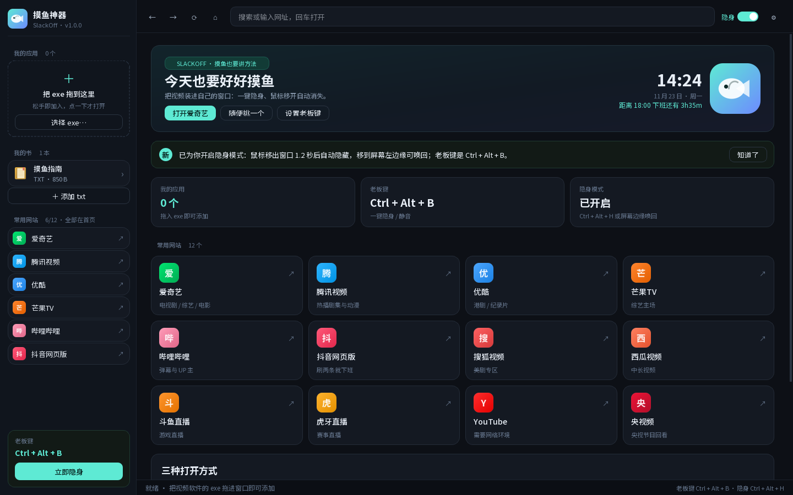
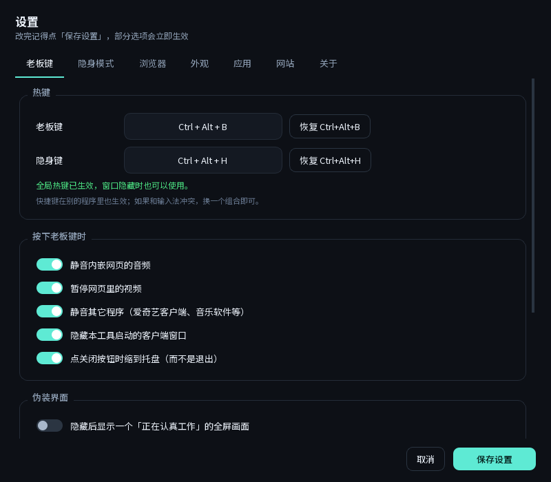
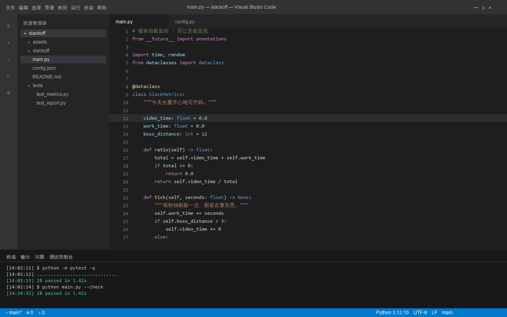
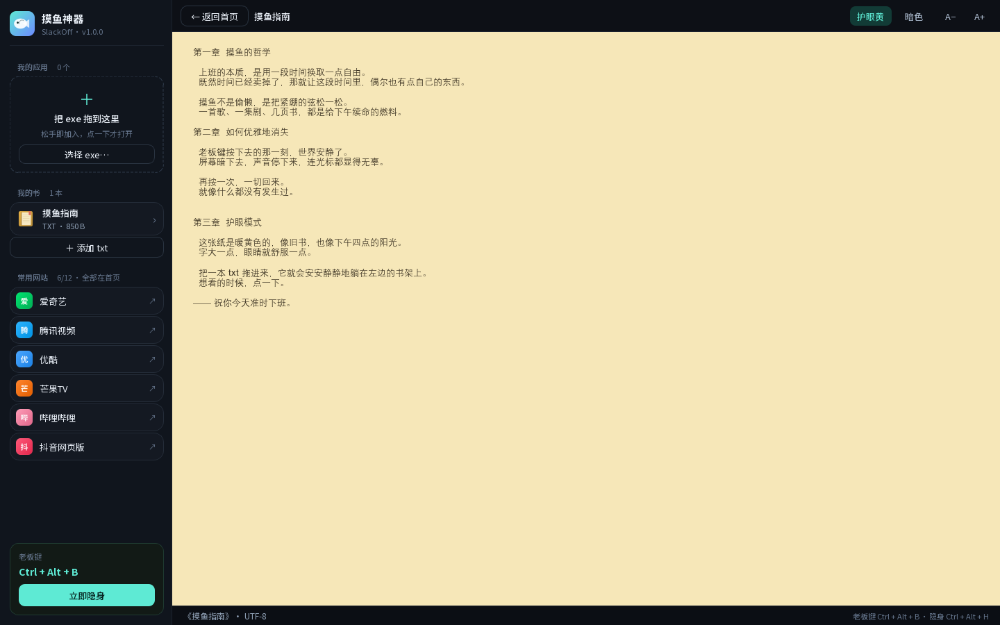
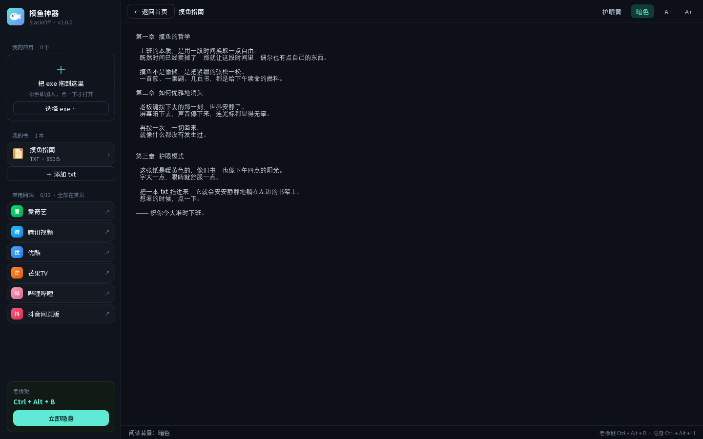
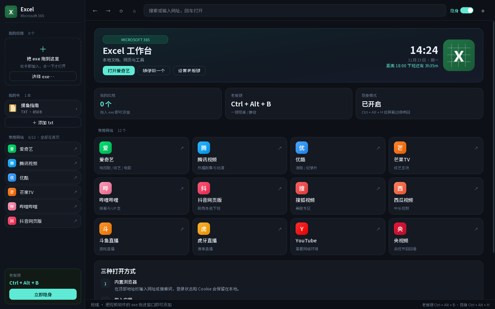

# 摸鱼神器 · SlackOff

> 把视频装进自己的窗口，老板一靠近就消失。

一个 Windows 桌面小工具：内置浏览器直接看爱奇艺 / 腾讯视频 / 优酷 / B站；
把本地视频软件的 exe 拖进窗口，就会出现在左侧，点一下即启动。
支持**全局老板键**与**鼠标移开自动隐身**。纯本地运行，不联网上报、不需要登录任何第三方账号。



| 设置 | 伪装界面（老板键隐藏后） |
| --- | --- |
|  |  |

| 护眼黄 | 暗色 |
| --- | --- |
|  |  |



## 功能

- **内置浏览器**：基于 QtWebEngine（Chromium），地址栏输入网址或搜索词即可浏览；Cookie / 登录状态保存在本地。
  内置内核**不带 H.264 / AAC 解码器**（PySide6 官方 QtWebEngine 的编译限制，无法在运行期补上），
  所以爱奇艺 / 腾讯视频 / 优酷 / B站等**视频网站会自动改用系统 Edge 内核**打开——
  没有地址栏的 Edge 窗口盖在神器内容区里，登录、播放、DRM 都由 Edge 负责，老板键 / 隐身照样生效。
  没有装 Edge 时会退回 Chrome；两者都没有才留在内置浏览器（视频多半放不了）。
- **我的应用（拖入即用）**：把视频软件的 exe 或桌面快捷方式从资源管理器拖进窗口，
  就会加入左侧列表（不会立刻启动）；自动读取 exe 自带的图标和中文名称（例如 `QQLive.exe` → 腾讯视频），
  路径记在本地，点一下才打开。也可以点「＋ 添加应用」手动选择，右键条目可移除。
- **在工具内部打开程序（默认）**：点左侧应用时，程序窗口会被嵌进摸鱼神器——
  去掉它自己的标题栏，跟随摸鱼神器一起缩放；老板键 / 隐身会连同它一起隐藏。
  程序自己弹出的播放器 / 弹窗（比如腾讯视频选片后的播放窗口）也会自动收进来，
  关掉后回到主界面。
  注意：腾讯视频这类客户端会把**视频画面**放进一个单独的 GPU 窗口，Windows 不允许把它
  作为子窗口嵌入，所以会出现「播放器 UI 嵌入了、画面还在外面 / 是黑的」。遇到时会提示，
  可以点「独立窗口」正常播放，或用浏览器打开网页版。
  部分是 Windows 商店应用（UWP）或 Chromium / Electron 内核客户端，可能不支持嵌入或黑屏：
  点应用页右上角「独立窗口」就能放回普通窗口，也可以在「设置 → 应用」里关掉「在摸鱼神器内打开」。
- **TXT 电子书**：把 `.txt` 拖进窗口就会加入左侧「我的书」，并直接在工具里打开；
  **护眼黄 / 暗色**两种背景一键切换（暗色与主界面一致），可调字号（`A−` / `A+`），
  自动识别 UTF-8 / GBK / UTF-16；老板键、隐身同样适用。
- **外观伪装**：设置 → 外观里可以把左上角图标、名称、窗口标题、任务栏和托盘图标
  换成 Excel / WPS / Word / 记事本 / VS Code。只改外观，功能不变；
  任务栏的分组身份要重启一次才会完全切换。
- **下班倒计时可改**：首页右上的「距离 18:00 下班」点一下就能改时间——
  选预设（17:30 / 18:00 / 18:30 / 19:00）或直接输入，自动保存。
- **老板键（默认 `Ctrl + Alt + B`）**
  - 瞬间隐藏主窗口；
  - 静音网页音频并暂停视频；
  - 隐藏左侧「我的应用」里的程序窗口，并静音其它程序的音频（需要 pycaw）；
  - 可选「伪装界面」：全屏 VS Code 风格编辑器或 Excel 风格表格，按 `Esc` 退出。
- **隐身模式（默认开启）**
  - 鼠标移出窗口 1.2 秒后自动隐藏（延迟可调）；
  - 也可以改成「鼠标静止 N 秒后隐藏」；
  - 把鼠标贴到屏幕边缘（默认左侧，可改上下右/关闭）停留约 0.25 秒即可唤回（感应条约 12px 宽，可在设置里调大）；
  - 刚隐藏时边缘会亮一条极细的光带提示位置，4 秒后自动消失；
  - 顶部工具栏有开关，随时启用 / 停用。
- **托盘常驻**：关闭窗口默认缩到托盘；托盘菜单可显示/隐藏、立即隐身、开关隐身模式、设置、退出。
- **设置项**：热键录制、隐身延迟、唤回边缘、搜索引擎、浏览器 UA、页面缩放、下载目录、
  窗口置顶 / 不透明度 / 启动最大化、我的应用管理（含是否嵌入）、自定义网站、外观伪装。
- **全屏视频**：网页视频全屏时自动进入「影院模式」，隐藏侧栏与工具栏。

## 安装

要求：Windows 10/11，Python 3.10+（开发环境为 3.12）。

**方式一：一键安装（推荐）**

双击 `install.bat`。它会创建 `.venv` 虚拟环境并从腾讯云镜像安装依赖（约 300MB）。

**方式二：手动**

```bat
python -m venv .venv
.venv\Scripts\python.exe -m pip install -r requirements.txt -i https://mirrors.cloud.tencent.com/pypi/simple
```

> PySide6 体积较大（含 QtWebEngine）。如果下载慢，可以换成清华
> `https://pypi.tuna.tsinghua.edu.cn/simple` 或阿里云 `https://mirrors.aliyun.com/pypi/simple` 镜像。

## 启动

- 双击 `run.bat`（有控制台，方便看报错）
- 双击 `摸鱼神器.vbs`（无控制台窗口，日常使用）
- 命令行：`python main.py`

> 已经是单实例：重复双击只会把已经在运行的窗口叫到前面，不会再开一个新进程。

| 参数 | 说明 |
| --- | --- |
| `--hidden` | 启动后直接隐藏，等老板键唤回 |
| `--debug` | 控制台输出调试日志 |
| `--no-web` | 禁用内嵌浏览器，网站改用系统浏览器打开 |
| `--headless` | 无托盘、无全局热键（自动化测试用） |

## 使用

1. **看网页视频**：在地址栏输入 `iqiyi.com`、`v.qq.com` 或任意关键词，回车。左侧「常用网站」和首页卡片也能直接点。
   视频网站会自动用系统 Edge 内核打开；其它网页仍然用内置浏览器。内置浏览器里点进视频站
   （比如从搜索结果跳转过去）也会自动切到系统内核。右上角工具条的 **`E`** 按钮可以手动把当前页切到系统内核；
   优酷 / 芒果这类站点点视频时新开的播放窗口也会自动收进内容区，不会再单独弹到桌面。
   不想看时点页面顶部的「← 返回首页」会连同 Edge 进程一起关掉，点「独立窗口」则把它放回桌面。
   首页右上角的「距离下班」也可以点一下，改成你自己的下班时间。
2. **把客户端加进来**：从桌面或文件夹把视频软件的 **exe（或桌面快捷方式）拖进窗口**，
   松手就加入左侧「我的应用」（不会自动启动）。也可以点左侧「＋ 添加应用」选择文件，
   右键条目可以「从列表移除」。
3. **在工具里使用**：点左侧应用，默认会在摸鱼神器**内部打开**；点应用页右上角「独立窗口」
   可以把它放回桌面窗口，按 `Esc` 返回首页。
4. **看电子书**：把 `.txt` 拖进窗口 → 加入左侧「我的书」并直接进入阅读页；
   点左侧书名可再次打开，右上角可切换「护眼黄 / 暗色」、用 `A−` / `A+` 调字号，`Esc` 返回首页。
5. **老板来了**：按 `Ctrl + Alt + B`。窗口、声音、应用一起消失；再按一次回来。
6. **走开一下**：什么都不用做，鼠标移出窗口约 1.2 秒后自动隐身。
7. **回来**：鼠标贴屏幕左边缘停留一下，或按 `Ctrl + Alt + H`，或点托盘图标。

想让它看起来像别的软件：**设置 → 外观** 里选 Excel / WPS / Word / 记事本 / VS Code，
左上角、窗口标题和任务栏图标会一起换掉。

### 默认热键

| 功能 | 快捷键 |
| --- | --- |
| 老板键（隐藏 / 唤回） | `Ctrl + Alt + B` |
| 隐身（隐藏 / 唤回） | `Ctrl + Alt + H` |
| 聚焦地址栏 | `Ctrl + L` |
| 刷新页面 | `Ctrl + R` |
| 全屏视频 / 影院模式 | `F11` |
| 关闭伪装界面 | `Esc` |

热键都可以在「设置 → 老板键」里点一下然后直接按组合键重新录制（至少包含 Ctrl / Alt / Win 之一）。

## 数据与隐私

所有数据都在项目下的 `data/` 目录（可用环境变量 `SLACKOFF_HOME` 改位置）：

```
data/
├── config.json     # 你的设置
├── slackoff.log    # 运行日志（自动轮转）
├── webengine/      # 内置浏览器的缓存与 Cookie
├── edge-profile/   # 系统内核（Edge / Chrome）的缓存与 Cookie，视频站登录状态在这
└── downloads/      # 默认下载目录（若未指定）
```

- 不包含任何统计、上报或远程请求（除了你自己打开的网页）。
- 删除整个 `data/` 即可恢复初始状态。

## 常见问题

**拖进来的程序不见了 / 打不开？**
如果 exe 被移动或删除，左侧会显示「○ 文件不见了」。右键该条目 → 「从列表移除」，
再把新的 exe 拖进来即可。快捷方式只支持指向 exe 的 .lnk。

**应用嵌进去黑屏 / 没声音 / 打不开？**
Windows 只对传统 Win32 窗口开放「重父化」嵌入。UWP（新版记事本、画图等）会直接提示不支持；
部分 Chromium / Electron 客户端可能黑屏。点应用页右上角「独立窗口」放回普通窗口即可，
也可以在「设置 → 应用」关掉「在摸鱼神器内打开」，以后都按独立窗口启动。

**txt 打开是乱码？**
会自动尝试 UTF-8（含 BOM）、GBK / GB18030、UTF-16；仍然乱码说明编码比较特殊，
可以用记事本「另存为 → UTF-8」后再拖进来。

**老板键没反应？**
多半是组合键被输入法或其他软件占用了。去设置里换一个（例如 `Ctrl + Alt + M`）。
如果提示「全局热键不可用」，通常是安全软件拦截了键盘钩子；此时热键只在窗口内生效，仍可用托盘菜单。

**网页打不开 / 视频黑屏？**
视频站（爱奇艺 / 腾讯视频 / 优酷 / B站……）现在会自动走系统 Edge 内核，正常情况下不会再黑屏。
如果没自动切过去：在打开该网页后点工具条上的 **`E`** 按钮，手动切到系统内核。
仍然不行时先用系统浏览器访问同一网址对比，常见原因：站点需要登录、会员清晰度需要 Widevine/DRM、
或网络 / 代理问题。系统内核窗口第一次打开需要登录一次，之后登录状态保存在 `data/edge-profile/`。

**为什么不用 QtWebEngine 直接播？**
PySide6 官方构建的 QtWebEngine 没有编译 H.264 / AAC（也不带 Widevine），
这是版权原因导致的编译期限制，加启动参数或换 PyQt 都无法补上。视频网站只能交给系统内核。

**任务栏图标是 Python 的？**
Windows 图标缓存导致，重启资源管理器或重新登录即可。

**会不会被公司监控发现？**
本工具只做本地窗口隐藏，不修改任何系统监控软件。请自行遵守公司的设备与网络使用规定。

## 开发

```
slackoff/
├── config.py        # 设置模型与持久化
├── apps.py          # 「我的应用」：拖入、启动、图标与名称
├── books.py         # TXT 电子书：书架、编码识别、读取
├── disguise.py      # 外观伪装：Excel / WPS / Word 等图标与名称
├── embed.py         # 把程序窗口嵌进摸鱼神器（SetParent）
├── catalog.py       # 内置网站与搜索引擎
├── winapi.py        # ctypes 窗口操作（枚举 / 隐藏 / 深色标题栏）
├── audio.py         # pycaw 按进程静音
├── hotkeys.py       # 热键解析与全局钩子
├── stealth.py       # 隐身判定与边缘唤回
├── browser.py       # QtWebEngine 封装
├── edge_web.py      # 视频网站：系统 Edge / Chrome 内核窗口
├── decoy.py         # 伪装界面（代码 / 表格）
├── urls.py          # 地址栏解析
└── ui/              # 主窗口、首页、设置、主题
```

```bat
python -m unittest discover -s tests -v   :: 单元测试（96 个）
python dev.py                             :: 开发热重载：改 .py 自动重启（或双击 run_dev.bat）
python tools\screenshot.py                :: 离屏渲染界面截图（无需显示器）
python tools\gui_smoke.py                 :: 整窗冒烟：隐藏 / 唤回 / 拖入 / 阅读 / 退出
python tools\app_embed_smoke.py           :: 真实程序嵌入验证（需要桌面会话）
python tools\web_smoke.py                 :: 验证 QtWebEngine 能渲染网页
python tools\window_integration.py        :: 真实窗口隐藏 / 恢复测试
python tools\envcheck.py                  :: 检查全局热键与音频静音是否可用
```

> 离屏截图需要设置 `QT_QPA_FONTDIR=C:\Windows\Fonts` 并安装中文字体，否则 Qt 的 offscreen
> 平台找不到字体，中文会显示成方框。

打包成 exe（可选，体积约 200MB+）：

```bat
pip install pyinstaller
pyinstaller -w -n 摸鱼神器 --collect-all PySide6 main.py
```

QtWebEngine 的打包比较挑环境，建议直接分发 `run.bat` + 虚拟环境，或使用安装包工具。

## 免责声明

本工具仅用于个人时间管理与隐私保护，不鼓励在工作时间懈怠。
使用前请确认符合所在公司的规章制度；因使用本工具产生的后果由使用者自行承担。

## 许可证

本项目采用 [MIT License](LICENSE) 发布。
